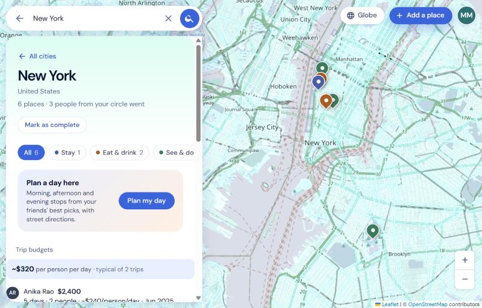
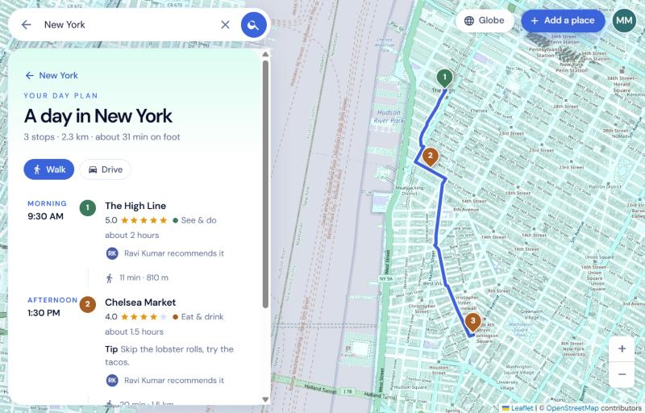

# MyCircle

Places your close friends have actually been, on one map.

**Try it now, no sign-in:** https://mycircle-inky.vercel.app/?demo





*Map data © OpenStreetMap contributors. Demo places and people are sample data.*

Search a city ("New York") and the map flies there. The side panel lists the friends in your circle who have been there. Pick a friend and the map shows only their places as numbered pins, with their rating, review and tip for each one.

## Run it on your computer

1. Double-click **start.bat** in this folder. It serves the app at **http://localhost:3000** and opens your browser.
   - It uses Python if you have it, otherwise `npx serve`. You can also run `python -m http.server 3000` yourself from this folder.
   - Keep port **3000** for local magic-link sign-in and allow that address in Supabase's redirect settings.
2. Enter your email and click **Email me a sign-in link**. Open the link on the same computer.
3. Pick your name, create your circle, and add a place with **Add a place**.

## Before you invite friends

Supabase's built-in email sender is only meant for testing. It sends to the members of your Supabase team, and only a few emails per hour. Friends won't get their sign-in email until you do these two things:

1. **Custom email (SMTP):** Supabase dashboard → Authentication → Emails → SMTP settings. A free Resend or Brevo account works. See https://supabase.com/docs/guides/auth/auth-smtp
2. **Where the app lives:** when you put it online (Vercel, GitHub Pages or Netlify), add that address under Authentication → URL Configuration. Set it as the Site URL, and add it under Redirect URLs.

Then use **Invite friends** in your account menu (the round button, top right) to copy your circle's invite link.

## Deploy on Vercel

The production URL is [mycircle-inky.vercel.app](https://mycircle-inky.vercel.app/). The release build copies web assets into `dist/` and applies the response headers in [vercel.json](vercel.json). Production builds require the private 3D landing page because the current deployment includes it.

From a checkout containing the private `landing/` project, install and build it, then package the site:

```sh
npm ci --prefix landing
npm run build --prefix landing
node --test tests/circle-data.test.mjs
node scripts/build.mjs --require-landing
```

A Git-only checkout can run `node scripts/build.mjs` for a preview with the email sign-in form. Use a local prebuilt release for the full site so Vercel receives the bundled landing page. With the Vercel CLI linked to the existing MyCircle project, run `vercel pull --environment=production` and `vercel build --prod`, then stage with `vercel deploy --prebuilt --prod --skip-domain`. [Vercel CLI deployment guide](https://vercel.com/docs/cli/deploying-from-cli)

Before promoting the staged deployment:

- Use a separate preview build with a test Supabase project for authenticated testing. Set `MYCIRCLE_SUPABASE_URL` and `MYCIRCLE_SUPABASE_PUBLISHABLE_KEY` for that preview. Confirm the staged production build points to the live project before promoting it. The defaults in `js/config.js` point to the current live project.
- Confirm Supabase's Site URL is the production origin, the exact callback URLs are allowed, and the custom SMTP sender delivers a magic link to an address outside the project team. If a Vercel preview has access protection, the recipient also needs access to that preview. [Redirect URLs](https://supabase.com/docs/guides/auth/redirect-urls) · [Custom SMTP](https://supabase.com/docs/guides/auth/auth-smtp)
- Check the map, the 3D landing page, and `/?demo`. With two test accounts, create and join a circle, save and reload a review and trip budget, and add and remove a photo. Use a third account outside the circle to verify that circle data and private photo URLs cannot be retrieved through the API. [Supabase production security checklist](https://supabase.com/docs/guides/security/production-checklist)
- Verify the current map, search, routing, and outline providers suit the expected traffic, and check the project’s backup and recovery settings. Promote the staged deployment with `vercel promote <deployment>` once the checks pass.

## How it works

| File | What it does |
|---|---|
| `index.html` | Page layout: map, search box, side panel and dialogs |
| `css/app.css` | Styles, including the bottom-sheet layout for phones |
| `js/app.js` | All app logic: sign-in, circles, city search, friend view, adding reviews |
| `js/circle-data.mjs` | Fetches members, places, reviews, photos, and trip budgets for one circle |
| `js/config.js` | Supabase project URL and publishable key, map tiles, search service |
| `js/country.js` | Country lookup, coverage maths and the country-shaped backdrop |
| `js/globe.js` | **Globe** button: your circle's cities on a 3D globe, with arcs from your country and each friend's trips. Loaded only when opened |
| `vendor/` | Local copies of Leaflet 1.9.4 (map), supabase-js 2.117, three.js 0.186 (globe) and country outlines |

**Data** lives in the `mycircle` Supabase project:

- **Tables:** `profiles`, `circles`, `circle_members`, `places`, `reviews`, `photos` and `trips`.
- **Trip budgets:** in a city's panel, "Add what your trip cost" saves one total per person per city (`trips`), in the currency they paid, with optional days, number of people, month and a short note. The city shows each budget, its cost per person per day, and a typical figure: the median per person per day in the currency most people used. Amounts are never converted between currencies.
- **Photos:** "Add photos" in a place's popup. Each photo is shrunk to 1600px and re-saved as a JPEG in the browser (which also strips the camera's location data), then stored in the private `photos` storage bucket at `<place id>/<random>.jpg`. Only members of that place's circle can view them, through links that expire after an hour. You can delete only your own photos.
- **Visibility:** row-level security limits everything to your own circles. People outside a circle see nothing, and friends can only edit their own reviews.
- **Places:** each place is stored once per circle. A place disappears when its last review is deleted.
- **Keys:** the publishable key in `config.js` is safe to ship in the browser. It can't get past those rules.

**Services used from the browser:**

- **Map tiles:** OpenStreetMap's standard map, which needs no key.
- **Search:** city and place search through Photon (photon.komoot.io), which is built on OpenStreetMap.
- **Day plans:** street directions between stops come from FOSSGIS routing (routing.openstreetmap.de, OpenStreetMap data). The coordinates of the planned places are sent to it; nothing else is. Change `routeUrl` in `config.js` to use another OSRM server.

Both are free for small, personal use. If MyCircle grows to many users, switch the tile and search URLs in `config.js` to a keyed provider such as MapTiler or Stadia Maps.

## Promo video (Remotion)

The `video/` folder is a separate [Remotion](https://www.remotion.dev) project that renders a 16-second promo using the app's colours and fonts. It is not part of the website.

```
cd video
npm install
npm run studio    # live preview in the browser
npm run render    # writes video/out/mycircle-promo.mp4
```

Edit scenes in `video/src/Promo.tsx`.

## Signed-out landing page (3D)

The original signed-out page is a private React + Three.js app in `landing/` (not in this repository). When `landing/dist/` isn't there, MyCircle shows a simple email sign-in card instead, so everything else works the same.

## Your country and coverage

The first time you sign in, MyCircle asks which country you are from. It is saved on your sign-in account (no database change) and can be changed from the account menu. Your country sets the app's colours and a country-shaped backdrop, and the home panel shows two numbers, based on the places you have reviewed:

- **Your country:** the share of its land within about 100 km of a place you've been.
- **The world:** how many of the 174 countries on our map you have a place in.

Country outlines are bundled in `vendor/countries.js` (Natural Earth 110m, public domain), so nothing is looked up online. Very small countries are missing from that map data.

## Completed areas

Search any country, state or city and tap **Mark as complete**. The area is painted red on the map, on every screen, and listed on the home panel (tap a name there to remove it). Up to 40 areas. The list is stored on your sign-in account; the outlines come from OpenStreetMap's Nominatim service (https://nominatim.openstreetmap.org, free for light use, about one request a second) and are cached on your device.

## Using it

- **Search a city:** type in the search box. Cities your circle has already been to show up first.
- **Pick a friend:** see their places in that city as numbered pins, matching the numbered list.
- **Tap a pin or list item:** see everyone's reviews of that place, open it in Google Maps, or add your own review.
- **Search this area:** appears after you drag the map. It lists friends and places in whatever you're looking at.
- **Plan a day:** in a city, tap **Plan my day**. You get a morning, afternoon and evening stop picked from your friends' best-rated places, with times, tips, and walking or driving directions drawn along real streets on the map. Plans are made on the fly and not saved.
- **Add a place:** search for it by name, near where the map is. If search can't find it, drop a pin on the map instead.

## Contributing

Developers and designers are welcome. Run `python -m http.server 3000` and open http://localhost:3000/?demo to try it with no sign-in. See [CONTRIBUTING.md](CONTRIBUTING.md) for where things are and how to send a change.

## License

All rights reserved. The code is public so people can read it and contribute; it may not be copied or hosted elsewhere. See [LICENSE](LICENSE).
